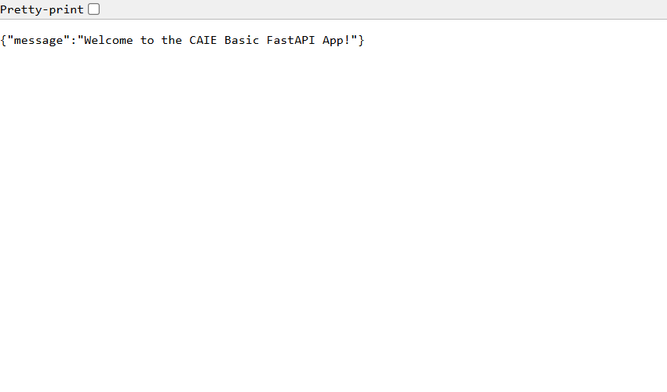
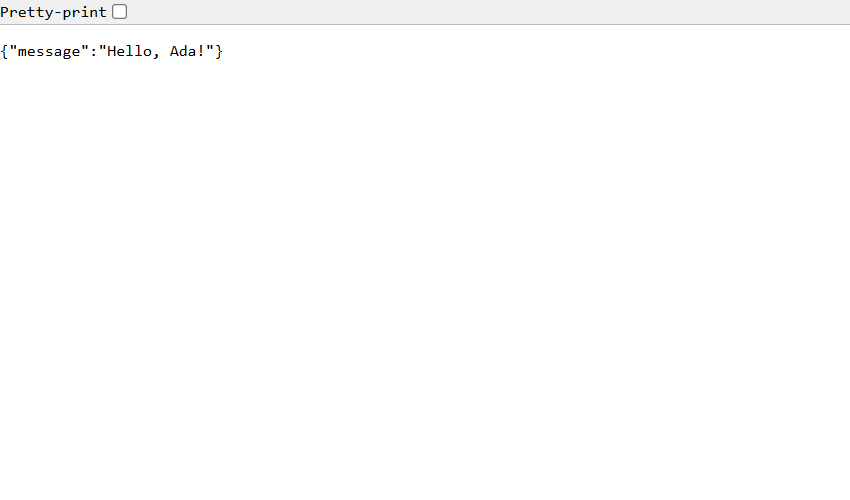
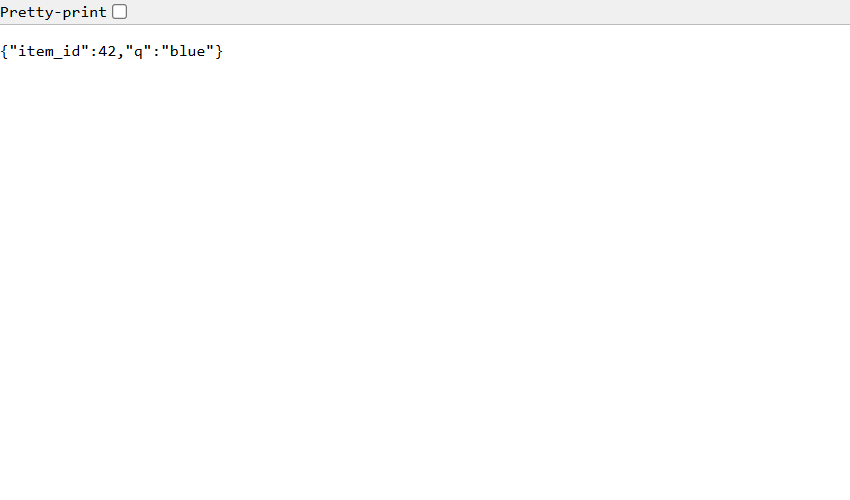
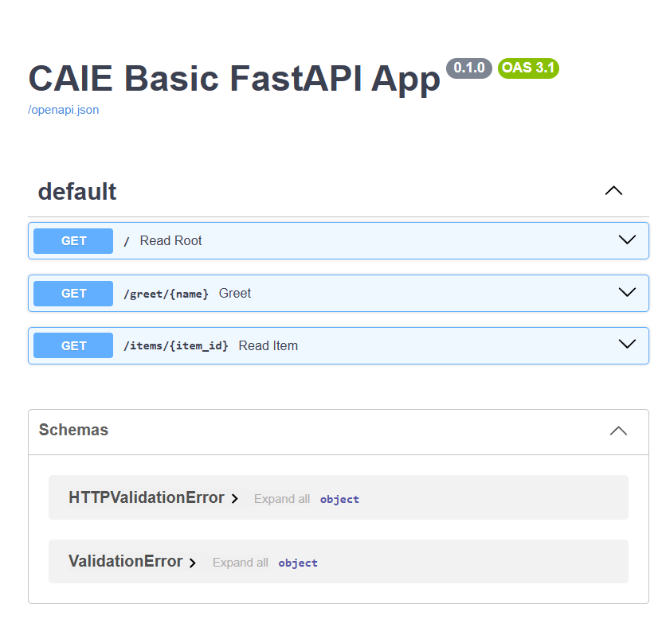

# Basic FastAPI App

> Three small endpoints that show FastAPI routing, path and query parameters, and auto docs.

  

## Overview

A minimal [FastAPI](https://fastapi.tiangolo.com) service. It shows async route handlers, typed path parameters, an optional query parameter and the interactive Swagger UI that FastAPI generates automatically.

## Features

- `GET /` welcome message
- `GET /greet/{name}` path parameter
- `GET /items/{item_id}?q=` typed path + optional query
- Interactive docs at `/docs`

## Demo






## Tech stack

| Layer | Technology |
|---|---|
| API | FastAPI |
| Server | Uvicorn |

## Project structure

```text
.
├── main.py
└── requirements.txt
```

## Getting started

**Prerequisites:** Python 3.10+

```bash
git clone https://github.com/prasanth-sundararajan/Fastapi-Smallapp.git
cd Fastapi-Smallapp
python -m venv .venv
# Windows: .venv\Scripts\activate    macOS/Linux: source .venv/bin/activate
pip install -r requirements.txt
```

## Usage

```bash
uvicorn main:app --reload
```
Open http://127.0.0.1:8000/docs

## License

Released under the [MIT License](LICENSE).

## Author

**Prasanth Sundararajan**, Senior SRE and AI Engineer  
[LinkedIn](https://www.linkedin.com/in/prasanth-s-a093a7109/) · [GitHub](https://github.com/prasanth-sundararajan)
